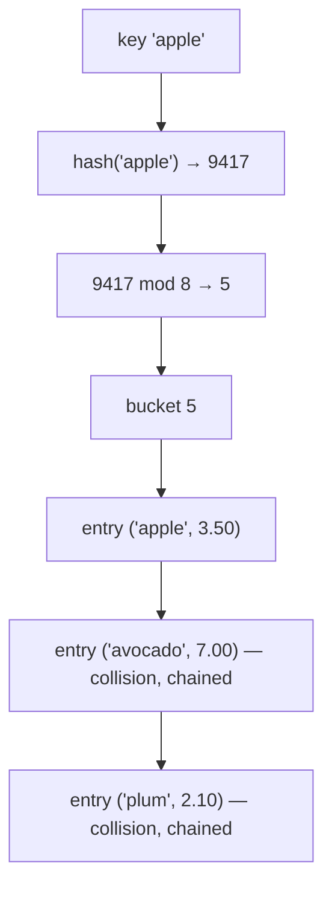

# Hash Tables: Theory &amp; TypeScript Implementation Guide

TypeScript is fully sufficient for this: a hash table never needs raw memory control. Everything — hashing, bucket arrays, collision resolution, resizing — can be built with plain arrays and objects, and you will understand every layer.

---

## Part 1 — Theory

### 1.1 The problem a hash table solves

You want a **map**: store `key → value` pairs and later ask "what's the value for this key?" — as fast as possible.

- A sorted array: lookup is O(log n), insert O(n).
- A linked list: lookup O(n).
- An **array indexed directly**: O(1)… but only works when keys are small integers `0…n-1`.

A hash table gets O(1) average lookup/insert/delete for *arbitrary* keys (strings, numbers, objects) by converting any key into an array index.

### 1.2 The core idea

1. Keep an ordinary array, called the **bucket array** (capacity `m`).
2. A **hash function** `h(key)` converts any key into a large integer.
3. `h(key) mod m` (or `h(key) & (m-1)` if `m` is a power of two) gives a bucket index in range.
4. The pair is stored in that bucket.



A lookup repeats exactly these steps: hash → index → scan the bucket → compare keys with strict equality → return the value.

### 1.3 Hash functions

Requirements for a good hash function:

- **Deterministic**: same key → same hash, always.
- **Uniform**: outputs spread evenly across the whole range; similar keys should *not* produce similar hashes.
- **Fast**: it runs on every operation, so it must be cheap.

For **string keys**, implement a classic rolling hash — FNV-1a (recommended for your exercise):

```text
hash = 2166136261                 // FNV offset basis
for each byte b of the string:
  hash = hash XOR b
  hash = (hash * 16777619) >>> 0  // FNV prime; >>> 0 keeps it unsigned 32-bit
return hash
```

The multiplication "mixes" the previous characters into the result, so `"ab"` and `"ba"` hash differently.

For **non-string keys** (numbers, booleans, objects): convert to a string first (`String(key)`), then run the string hash. For objects, decide your rule — often `JSON.stringify` or an explicit `id` field. Keep it simple: require keys to be primitives for your first version.

**Why power-of-two capacity?** With `m = 2^k`, `hash mod m` equals `hash & (m - 1)`, which is a single cheap CPU instruction. This is why Java's `HashMap`, V8's `Map`, and Python's `dict` (which also sizes to convenient primes internally) all choose capacities carefully.

### 1.4 Collisions — the heart of the topic

Two different keys can land in the same bucket. This is **guaranteed** to happen (pigeonhole principle: infinitely many possible keys, only `m` buckets). The birthday paradox makes it happen *quickly*: with only \~950 keys hashed into 4096 buckets, there is a 50%+ chance of a collision even with a perfect hash. Collision resolution is what makes one hash table different from another.

**Strategy A — Separate chaining** (recommended first implementation):

Each bucket holds a small list of entries. On collision, append to the list. On lookup, walk the list and compare keys. Worst case: all keys in one bucket → O(n).

**Strategy B — Open addressing**:

All entries live directly in the bucket array. If slot `i` is taken, **probe** for another: `i+1, i+2, …` (**linear probing**), `i+1, i+4, i+9, …` (**quadratic probing**), or `i + k·h2(key)` (**double hashing**). Lookup follows the same probe sequence until it finds the key, an empty slot (definitely absent — stop), or scans the whole table.

Open addressing deletion is subtle: replacing a deleted entry with "empty" would break probe chains. The fix is a **tombstone** marker: deleted slots are marked "deleted, keep probing" rather than "empty, stop probing". Tombstones accumulate, so the table must be periodically rebuilt.


|                           | Separate chaining        | Open addressing           |
| ------------------------- | ------------------------ | ------------------------- |
| Storage per entry         | Extra node/list overhead | Compact, inside the array |
| Cache friendliness        | Poor (pointer chasing)   | Excellent                 |
| Load factor limit         | Can exceed 1.0           | Must stay &lt; \~0.75     |
| Delete                    | Easy (unlink node)       | Needs tombstones          |
| Implementation difficulty | Easy                     | Medium-hard               |


### 1.5 Load factor, resizing, and amortized O(1)

**Load factor** `α = n / m` (entries ÷ capacity). Performance degrades as α grows: chaining lists get longer; open addressing probe runs get longer (with a catastrophic blowup as α → 1).

Fix: when α crosses a threshold (typically **0.75**), **resize**:

1. Allocate a new bucket array (usually **double** the capacity, keeping it a power of two).
2. **Rehash** every entry: you cannot copy entries between buckets directly, because each entry's index depends on the capacity. Every key must be hashed again with the new `m`.

A resize costs O(n), but it happens after the table has doubled in size, so averaged over many insertions each `set` is **O(1) amortized**. This is the same reasoning as dynamic arrays (`Array.prototype.push`).

Optionally also **shrink** when α falls below \~0.25 after deletions to reclaim memory.

### 1.6 Complexity summary


| Operation | Average        | Worst case              |
| --------- | -------------- | ----------------------- |
| `set`     | O(1) amortized | O(n)                    |
| `get`     | O(1)           | O(n) — all keys collide |
| `has`     | O(1)           | O(n)                    |
| `delete`  | O(1)           | O(n)                    |
| `clear`   | O(m)           | O(m)                    |
| Space     | O(n + m)       | O(n + m)                |


### 1.7 Key equality and edge cases you must decide

- **Equality rule**: use strict equality (`===`) on keys. Note `NaN !== NaN`; real Maps use "SameValueZero" (treats all `NaN`s as equal). Pick one and document it.
- **`get` returning `undefined`** is ambiguous: missing key vs. stored value that *is* `undefined`. Distinguish via `has`, or internally store a sentinel/`Map` of entries so you always know whether an entry exists.
- Overwriting an existing key must **not** increase `size`.
- `delete` of a missing key returns `false` and changes nothing.

### 1.8 What builds on hash tables

- **JS objects, `Map`, `Set`** — `Map` is a real hash table; `Set` is a `Map` with dummy values; plain objects use hidden classes with a hash-table fallback.
- **Python `dict`** — open addressing, stores insertion order.
- **Caches and memoization** — "have I seen this input before?" in O(1).
- **Deduplication** — turn list dedup from O(n²) to O(n).
- **Symbol tables / environments** in interpreters and compilers (variable name → value).
- **Database hash indexes** (complementary to B-tree indexes: O(1) equality lookups, no range queries).

---

## Part 2 — The interface to implement

Implement `HashMap<K, V>` with **separate chaining and dynamic resizing**. Every method below is specified; the bodies are yours to write.

```ts
/**
 * A generic hash table mapping keys of type K to values of type V.
 * Strategy: separate chaining, power-of-two capacity, resize at load factor 0.75.
 * Key equality: === (document your NaN rule).
 */
export class HashMap<K, V> {
  /**
   * Number of stored key→value pairs.
   * Must be maintained incrementally by set() and delete().
   */
  readonly size: number; // implement as a private getter over this._size

  /**
   * Internal bucket array. Each bucket is either null
   * or the head of a singly-linked chain of entries.
   * Invariant: capacity is always a power of two.
   */
  private buckets: Array<EntryNode<K, V> | null>;

  private _size: number; // number of entries
  private static readonly INITIAL_CAPACITY = 16;
  private static readonly LOAD_FACTOR_THRESHOLD = 0.75;

  /**
   * Create an empty table with INITIAL_CAPACITY buckets.
   */
  constructor();

  /**
   * Insert the pair, or overwrite the value if the key already exists.
   *
   * Steps:
   *  1. hash the key, compute bucket index
   *  2. walk the chain: if a node with this key exists, replace its value
   *     (size unchanged) and return
   *  3. otherwise prepend a new node to the chain, _size++
   *  4. after inserting, if _size / capacity >= 0.75, resize(2x)
   *
   * @returns this (to allow chaining like map.set(k, v).set(k2, v2))
   */
  set(key: K, value: V): this;

  /**
   * Return the value stored under key, or undefined if the key is absent.
   * Must distinguish "key missing" from "value is undefined":
   * internally always check node existence, not the value.
   */
  get(key: K): V | undefined;

  /**
   * Return true iff the key exists.
   * Reuse the same chain-walking logic as get().
   */
  has(key: K): boolean;

  /**
   * Remove the key. Returns true if it existed (and was removed),
   * false if the key was absent. Decrements _size on success.
   */
  delete(key: K): boolean;

  /**
   * Remove all entries and reset to INITIAL_CAPACITY.
   * (Resetting capacity is optional; clearing the array is mandatory.)
   */
  clear(): void;

  /**
   * Snapshot of all keys, in any order.
   */
  keys(): K[];

  /**
   * Snapshot of all values, matching the order of keys().
   */
  values(): V[];

  /**
   * Snapshot of all [key, value] tuples, in any order.
   * keys()[i] must pair with values()[i] here.
   */
  entries(): Array<[K, V]>;
}

/**
 * A single node in a bucket chain.
 */
interface EntryNode<K, V> {
  key: K;
  value: V;
  next: EntryNode<K, V> | null;
}
```

### Internal helpers to write

```ts
/**
 * Hash ANY key into an unsigned 32-bit integer.
 * Strategy: String(key) → FNV-1a over UTF-16 code units.
 * MUST be deterministic. Test: same input → same output, every time.
 */
private hash(key: K): number;

/**
 * Map a hash to a bucket index.
 * Requires capacity to be a power of two.
 * Implementation: hash & (capacity - 1).
 * Explain to yourself why this equals hash % capacity here.
 */
private indexOf(hash: number): number;

/**
 * Shared logic for get/has/delete: walk the chain in bucket indexOf(hash(key))
 * and find the node whose key === the search key.
 * Return the node (or null). delete() will also need the PREVIOUS node
 * to unlink — consider returning {node, prev} or writing findEntryWithPrev().
 */
private findEntry(key: K): EntryNode<K, V> | null;

/**
 * Grow (or shrink) the bucket array to newCapacity (a power of two),
 * then REHASH every existing entry into the new array.
 * You cannot reuse old indexes: index depends on capacity.
 * A clean approach: iterate all old chains, collect nodes,
 * reset the table with the new array and _size = 0,
 * then re-insert each pair via set() — but watch out:
 * set() itself triggers resize. Guard it (e.g. an internal flag, or
 * re-insert nodes directly without going through set()).
 */
private resize(newCapacity: number): void;
```

---

## Part 3 — Milestones

Build in this order; each milestone is independently testable.

### Milestone 1 — Static table with chaining

Fixed capacity (16), no resizing yet. Implement: constructor, `hash`, `indexOf`, `findEntry`, `set`, `get`.
**Done when:** you can insert `cat`, `dog`, `bird`, look each up, overwrite one, and deliberately force a collision (temporarily set capacity to 2 and insert 5 keys — all should still be findable).

### Milestone 2 — Full basic API

Add `has`, `delete`, `size`, `clear`, `keys`, `values`, `entries`.
**Done when:** deleting a key removes exactly it, `size` never drifts, and entries/keys/values stay consistent after mixed operations.

### Milestone 3 — Dynamic resizing

Implement `resize` and hook it into `set`.
**Done when:** inserting 10,000 random string keys keeps every single one retrievable, and you can print capacity growth (16 → 32 → 64 → …). Your collision-heavy capacity-2 hack from Milestone 1 should now be impossible to observe externally.

### Milestone 4 (stretch) — Open addressing

Re-implement the same public interface with linear probing and tombstones: the bucket array holds entries directly (or null / DELETED markers). Compare the code: which parts got easier, which harder?

### Milestone 5 (stretch) — Iterable table

Implement `[Symbol.iterator]()` on `entries()` so `for (const [k, v] of map)` works, and a static `fromEntries(pairs)` factory.

---

## Part 4 — Test checklist

Tick each behavior off with a quick assertion script:

- [ ] `set` a new key → `get` returns the value, `size` is 1
- [ ] `set` the same key twice → value overwritten, `size` still 1
- [ ] `get` a missing key → `undefined`
- [ ] Value `undefined` stored explicitly → `get` returns `undefined` but `has` returns `true`
- [ ] `has` on missing key → `false`
- [ ] `delete` existing key → `true`; `get` now misses; `size` decremented
- [ ] `delete` missing key → `false`; nothing changes
- [ ] After many inserts past the resize threshold, EVERY key inserted earlier is still retrievable (loop over 10,000 keys)
- [ ] Capacity is always a power of two, before and after any resize
- [ ] `clear` → `size === 0`, all lookups miss
- [ ] `keys().length === values().length === entries().length === size` at all times
- [ ] Hash determinism: `hash("abc")` equals itself on every call
- [ ] Hash distribution: 10,000 distinct keys into capacity 1024 — no bucket holds more than \~20 entries (mean α ≈ 9.8; a good hash keeps chains near the mean)
- [ ] Performance sanity: 1M `set` + 1M `get` complete in a few seconds, roughly linear — not quadratically

---

*Next step: start with Milestone 1. When your implementation passes a milestone's checks, bring it back for review — including a probe-by-probe walkthrough of Milestone 4 if you take it on.*
